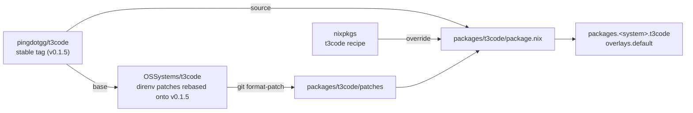
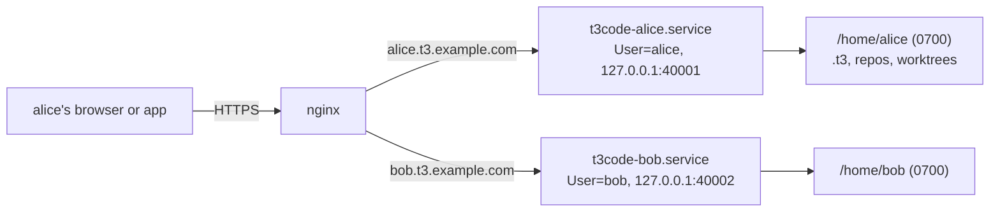

# t3code-nix

Nix packages for [T3 Code](https://github.com/pingdotgg/t3code) stable releases,
with patches that upstream does not have yet.

## Why

The `t3code` package in nixpkgs builds the upstream release as-is. We need
patches on top of it, such as direnv support for agents, while they wait for
upstream. This flake reuses the nixpkgs recipe and changes only the release, the
patches, and the hashes.

## How it fits together



## Use

```sh
nix build github:OSSystems/t3code-nix
nix run github:OSSystems/t3code-nix#t3code
```

Or add `overlays.default` to your nixpkgs. It replaces `t3code`.

## T3 Code OS

`nixosModules.t3code-os` turns one machine into a shared T3 Code host. T3 Code
has no user accounts: one server is one owner, with one database and one set of
provider credentials. So each person gets their own Unix user and their own
server, and the kernel keeps them apart.



```nix
{
  imports = [ inputs.t3code-nix.nixosModules.t3code-os ];

  services.t3code-os = {
    enable = true;
    domain = "t3.example.com";
    virtualHost = {
      forceSSL = true;
      useACMEHost = "t3.example.com"; # a wildcard certificate
    };
    extraPackages = [ pkgs.claude-code ];
    users.alice = {
      port = 40001;
      environment.ANTHROPIC_BASE_URL = "https://llm-proxy.example.com";
      environmentFile = config.sops.secrets."t3code-os/alice".path; # ANTHROPIC_AUTH_TOKEN=...
    };
  };
}
```

Each user is served at `<user>.<domain>`; T3 Code does not work under a
subpath. To let someone in, an admin creates a one-time link and sends it:

```sh
sudo t3os-pair alice           # add --ttl 1h for a longer-lived link
```

Opening the link signs that browser in. A new device needs a new link.

`nix flake check` runs `checks/t3code-os.nix`, a VM test of two users pairing
over HTTPS and failing to reach each other.

## Packages

Each directory in `packages/` with a `package.nix` is one package. A package
with the same name as a nixpkgs package receives the nixpkgs one and overrides
it.
