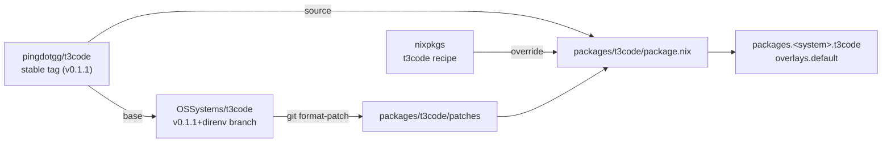

# t3code-nix

Nix packages for [T3 Code](https://github.com/pingdotgg/t3code) stable releases,
with patches that upstream does not have yet.

## Why

The `t3code` package in nixpkgs builds the upstream release as-is. We need
patches on top of it, such as direnv support for agents, while they wait for
upstream. This flake reuses the nixpkgs recipe and changes only the release, the
patches, and the hashes.

## How it fits together



## Use

```sh
nix build github:OSSystems/t3code-nix
nix run github:OSSystems/t3code-nix#t3code
```

Or add `overlays.default` to your nixpkgs. It replaces `t3code`.

### Home Manager

`homeManagerModules.default` sets defaults for the `programs.t3code` module of
Home Manager:

- `package` is the `t3code` from this flake.
- New threads use Opus 5.5 (`userSettings.defaultModelSelection`).

```nix
{
  imports = [ inputs.t3code-nix.homeManagerModules.default ];
  programs.t3code.enable = true;
}
```

On each activation, Home Manager merges `userSettings` into
`~/.t3/userdata/settings.json` and keeps the other keys. A default model picked
in the UI goes back to Opus 5.5 on the next switch. To use another model, set
`programs.t3code.userSettings.defaultModelSelection`; set it to `null` to go
back to "Automatic".

## Packages

Each directory in `packages/` with a `package.nix` is one package. A package
with the same name as a nixpkgs package receives the nixpkgs one and overrides
it.
